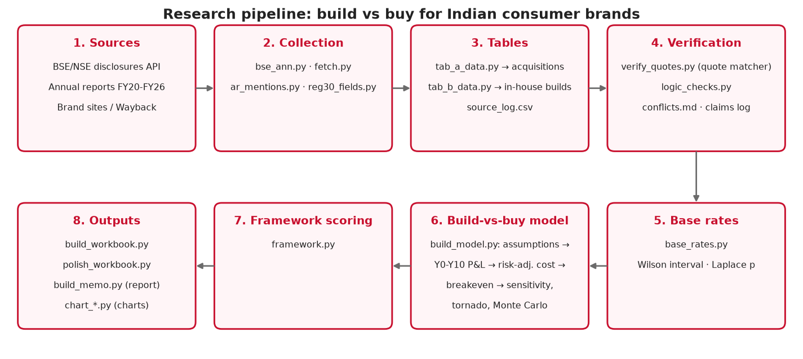
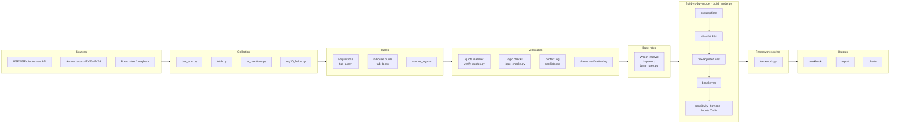
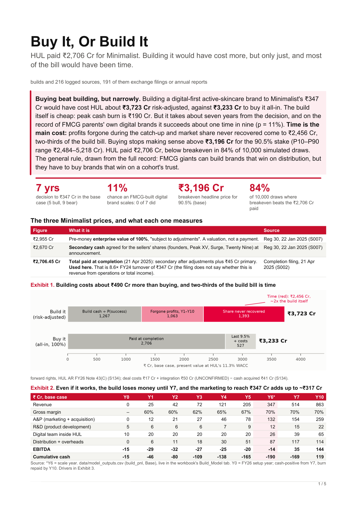
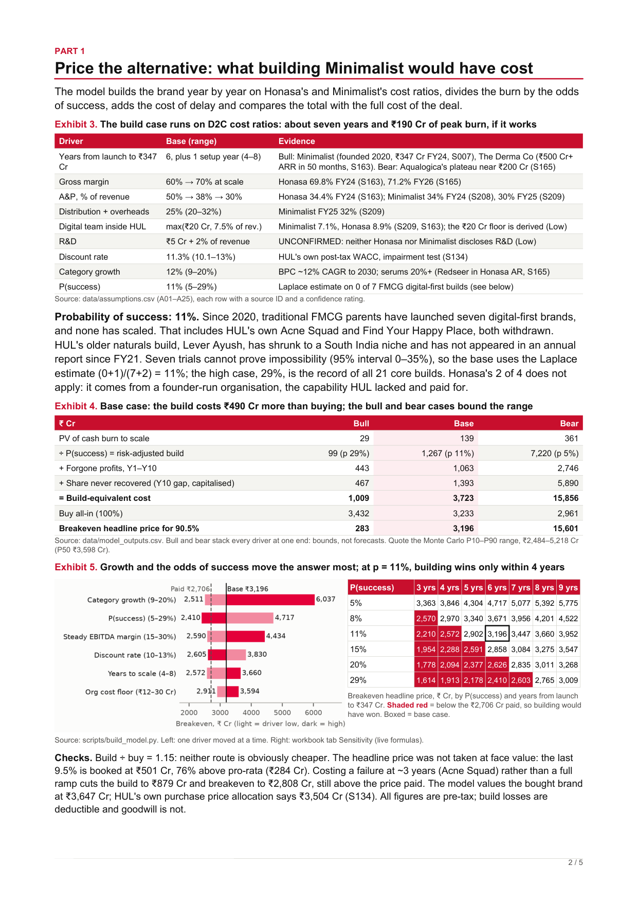
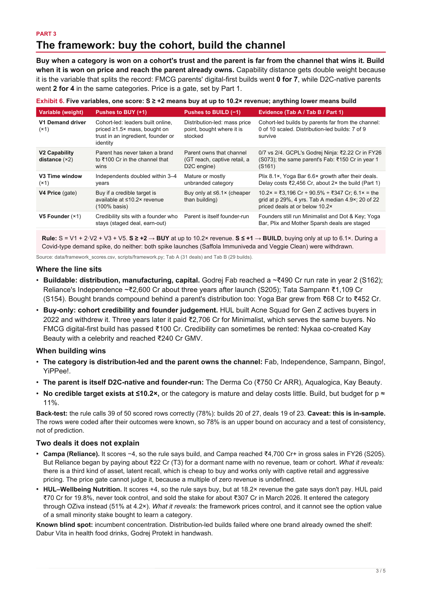
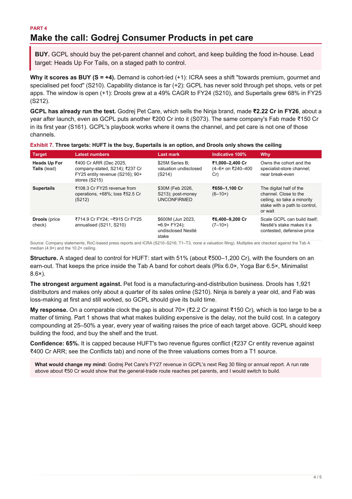

# Build vs Buy: a research automation pipeline for Indian consumer brands

A reproducible research pipeline that asks one question of Indian listed FMCG and consumer companies: **when a large parent wants a brand in a new or fast-growing category, is it cheaper to buy one or to build one in-house?** The pipeline pulls primary disclosures (stock-exchange filings and annual reports), turns them into two evidence tables (31 acquisitions and 29 in-house brand launches), verifies every quote and headline number against the saved source text, derives base rates for in-house success, and prices the alternative with a risk-adjusted build-vs-buy model. The worked example is Hindustan Unilever's 2025 acquisition of the skincare brand Minimalist.

---

## Headline results (base case, ₹ Cr, 100% basis)

| Measure | Value | What it means |
|---|---:|---|
| Price paid at completion (90.5% stake) | **₹2,706** | Reg 30 completion filing, 21 Apr 2025 (S002) |
| Build-equivalent cost (risk-adjusted build + cost of delay) | **₹3,723** | What it would have cost to build a ₹347 Cr brand in-house |
| Buy all-in cost | **₹3,233** | Headline price + remaining stake + deal and integration costs − cash acquired |
| Breakeven headline price | **₹3,196** | Above this, building would have been cheaper |
| P(success) of an in-house digital-first build | 11% | Laplace estimate from 0 successes in 7 traditional-FMCG builds |
| Monte Carlo (10,000 draws) | 84% | Share of draws where breakeven exceeds the price paid |

Buying beat building, but narrowly, and most of the build bill is time: forgone profits and market share never recovered make up about two-thirds of the build-equivalent cost.

---

## Architecture





---

## How the model works

`scripts/build_model.py` reads `data/assumptions.csv`: 25 drivers, each with a low, base and high value, a source ID and a rationale. All money is in ₹ Cr, pre-tax. Y0 is the decision year (FY26).

1. **Assumptions.** These cover years to scale, Y1 revenue, gross margin (launch and scale), A&P (advertising and promotion) as a share of revenue, R&D, team cost, distribution, discount rate (WACC), terminal growth, P(success), and the costs of the remaining stake, the transaction and integration.
2. **Y0–Y10 P&L.** `build_pnl()` grows revenue from Y1 to the target (₹347 Cr) by year T. Margins move from launch levels to scale levels. It returns EBITDA, cash burn and cumulative cash for each year. `bought_path()` projects the acquired brand over the same years.
3. **Risk-adjusted build cost.**
   `risk_adjusted_build = PV(cash burn, Y0..T) / p`.
   The PV is taken at the WACC. Dividing by p charges for the attempts that fail.
4. **p via Laplace.** None of the 7 digital-first builds by traditional FMCG parents scaled (0 of 7, Wilson 95% interval 0–35%). A zero-success sample cannot support p = 0, so the base case uses the Laplace rule of succession: (0 + 1) / (7 + 2) ≈ 11%.
5. **Cost of delay.**
   `forgone profits = Σ PV(bought EBITDA − build EBITDA)` over Y1–Y10, where build EBITDA counts only after scale.
   `share loss = Y10 revenue gap × steady EBITDA margin / (r − g)`, discounted from Y10.
6. **Build-equivalent cost and breakeven.**
   `build_equivalent = risk_adjusted_build + cost_of_delay`
   `buy_all_in = headline price + remaining stake + transaction + integration − cash acquired`
   `breakeven_headline_price = build_equivalent − (buy_all_in − headline price)`
7. **Sensitivity.**
   - Bull and Bear scenarios move every operating driver to its build-favourable or build-unfavourable end.
   - A tornado chart moves one driver at a time between its low and high values.
   - A p × years-to-scale grid shows the breakeven price for each combination.
8. **Monte Carlo.** The model draws 10,000 samples from triangular(low, base, high) distributions for every driver, using NumPy with seed 42. The output is the distribution of breakeven prices (P10–P90 ₹2,484–5,218 Cr) and the share of draws above the price paid.

The workbook rebuilds the Bull, Base and Bear models and the sensitivity grid as live formulas that read the Assumptions tab. The tornado and Monte Carlo blocks are static outputs of the Python model.

---

## Data and evidence rules

**Source tiers**
| Tier | Covers |
|---|---|
| T1 | BSE/NSE filings, annual reports, CCI orders, MCA filings, company press releases and investor presentations |
| T2 | Earnings-call transcripts, DRHP/RHP, reputable press directly quoting company officials |
| T3 | Trade and business press, Tracxn/Crunchbase summaries |
| T4 | Blogs, Wikipedia, model memory. Never enough on its own. |

Of the 216 logged sources, 191 are T1, 1 is T2, 19 are T3 and 5 are T4.

**Confidence levels**
- **High:** a T1 source with a verbatim quote.
- **Medium:** a T2 source, or two independent T3 sources that agree.
- **Low:** a single T3 source, or a derived or inferred value.

**Rules applied to every row**
- Every figure carries a source ID, URL, verbatim quote and page reference.
- A value that cannot be confirmed is left blank and flagged `UNCONFIRMED: <reason>`. It is never estimated silently.
- When sources disagree, `data/conflicts.md` records each figure and what it actually measures: valuation vs consideration, 100% vs stake, before vs after adjustments. The most authoritative source wins.
- Revenue basis is recorded per row: revenue from operations, total income, or the filing's own wording.

**Quote verification.** `verify_quotes.py` re-checks 457 quotes and numbers against the saved source text.

| Result | Count |
|---|---:|
| PASS | 360 |
| PASS_OTHER_SOURCE | 20 |
| PASS_DERIVED | 4 |
| SKIPPED_SHORT (fewer than 3 words) | 60 |
| FAIL (each triaged by hand) | 13 |

The full results are in `data/verification_report.csv`.

**Logic checks.** `logic_checks.py` returns 0 errors and 13 warnings. The results are in `data/logic_checks.csv`.

---

## Pipeline stages and tooling

No script in this repository calls a language-model API. A search for `anthropic`, `openai`, `gemini`, `mistral`, `cohere`, `ollama` and `genai` across `scripts/` returns no imports or calls. LLM assistance was interactive, at the analyst's desk, and every figure it produced was checked against a filing before use.

| Stage | Method | Tool / model |
|---|---|---|
| Retrieval of exchange filings | Public BSE corporate-announcement and annual-report JSON endpoints, plus PDF download | `requests` (`bse_ann.py`, `fetch.py`, `ar_mentions.py`) |
| Text extraction | Page-marked PDF and HTML text extraction | `pdfplumber`, PyMuPDF, `html.parser` |
| Field extraction from Reg 30 filings | Rule-based regex parser for the standard annexure fields (cost of acquisition, shareholding %, turnover, objects, completion timeline) | `reg30_fields.py` (Python `re`) |
| Annual-report brand tracking | Regex mention counts per brand per FY | `ar_mentions.py` |
| Quote and number verification | Fuzzy substring match (partial_ratio ≥ 90) on normalised text | RapidFuzz (`verify_quotes.py`) |
| Consistency checks | Rule checks on schema, vocabulary, dates and derived multiples | `logic_checks.py` |
| Base rates | Wilson 95% interval; Laplace rule of succession | Python (`base_rates.py`) |
| Build-vs-buy model, sensitivity, Monte Carlo | Deterministic P&L and DCF; triangular sampling over 10,000 draws | NumPy, pandas (`build_model.py`) |
| Workbook, report and charts | Formula-driven xlsx; PDF layout; charts | openpyxl, reportlab, matplotlib |
| Reading filings, cross-checking figures, drafting text | LLM-assisted, with human review of every figure | Claude Opus 5.5 via Claude Code in VS Code (interactive, not called from any script) |

---

## LLM output verification

Every figure the LLM recalled from memory, rather than read from a source, was logged as a lead in `data/claims_verification_log.csv`. The log records the recalled value, the verified value, the source and how any mismatch was caught.

| Outcome | Count |
|---|---:|
| Initial figures logged | **72** |
| Matched the source | 28 |
| Partly matched (one element wrong, e.g. a valuation given as the price) | 10 |
| Wrong | 15 |
| Never confirmed (left blank in the tables) | 15 |
| Rejected on scope (parent not listed at deal time) | 2 |
| Not checked | 2 |

How the 25 wrong or partly matched figures were caught:

| How caught | Wrong | Partly matched |
|---|---:|---:|
| Exchange filing (Reg 30 / BSE) | 5 | 7 |
| Annual report | 5 | 2 |
| Press | 1 | 0 |
| Other (absence of evidence, scope rule) | 4 | 1 |

Three examples:

- **HUL–Minimalist price (C001, partial).** Recalled as "~₹2,955 Cr for 90.5%". The Reg 30 filing shows ₹2,955 Cr is the pre-money **enterprise value** of 100%. The secondary price agreed was ₹2,670 Cr, and the total paid at completion was ₹2,706.45 Cr.
- **Nykaa–Earth Rhythm stake (C023, wrong).** Recalled as "Nykaa acquired 51% (2022)". The Reg 30 filing shows the first stake was **18.51% for ₹41.65 Cr**. Nykaa reached about 75.83% only after the 2024–25 tranches.
- **ITC–Prasuma deal value (C007, wrong).** Recalled as "~₹375 Cr". ITC's Reg 30 filing shows **~₹131 Cr for 43.75%** (first tranche, 2025-04-04).

---

## Code walkthrough

The scripts below are listed in run order, from collection to outputs.

- **`bse_ann.py`** takes a BSE scrip code and a date range, and optionally a `--grep` filter. It calls BSE's public announcements JSON API and prints each announcement's date, headline and attachment PDF URL. It is used to find Reg 30 acquisition disclosures. Key function: `fetch()`.
- **`fetch.py`** is the source capture and search tool. `get` downloads a URL and saves page-marked text to `sources/raw/S###_slug.txt`. `add` registers text captured some other way. Both append a row to `data/source_log.csv`. `find` runs an exact or fuzzy phrase search across the saved text. If a request returns 403, it falls back to simpler User-Agent headers. It never bypasses a login or captcha. Key functions: `download()`, `pdf_to_text()`, `html_to_text()`, `append_log()`, `find()`.
- **`reg30_fields.py`** takes source IDs and prints the letter body and the standard Reg 30 annexure fields from each saved filing. The fields are cost of acquisition, percentage of shareholding, turnover, objects, completion timeline and consideration. It uses only regex rules.
- **`ar_mentions.py`** has two commands. `download` gets FY20–FY26 annual reports for each parent from the BSE AnnualReport API, caches them, and registers each one as a T1 source. `count` counts brand mentions per report and writes `data/ar_mentions.csv`, with a sample sentence for each count. Failed downloads are recorded, not retried around. Key functions: `ar_list()`, `get_one()`, `cmd_count()`.
- **`tab_a_data.py` / `tab_b_data.py`** hold the curated acquisition and in-house-build rows as Python dicts. Each row carries its source IDs, quotes, vocabulary codes and status evidence. They write `data/tab_a.csv` and `data/tab_b.csv` and upsert the claims-verification log. `multiple()` computes revenue multiples on a 100% basis. `base_rate_flag()` marks which builds count toward base rates.
- **`verify_quotes.py`** extracts every quoted span and headline number from both tables. It tests each one against the source it is attributed to, then against the row's other sources. The test is RapidFuzz `partial_ratio` ≥ 90 on normalised text. Results go to `data/verification_report.csv`. Key functions: `norm()`, `best_in()`, `check()`, `num_check()`, `derived_check()`.
- **`logic_checks.py`** checks schema, controlled vocabulary, date and scope rules, and computed multiples. Results go to `data/logic_checks.csv`, graded ERROR or WARN.
- **`base_rates.py`** reads the core rows of `tab_b.csv` and computes success rates under four definitions, each with a Wilson 95% interval. The output is `data/base_rates.csv`. Key function: `wilson()`.
- **`build_model.py`** is the build-vs-buy model described above. Its input is `data/assumptions.csv`. Its outputs are `data/model_outputs.csv` and the model charts. Key functions: `scenario()`, `build_pnl()`, `bought_path()`, `evaluate()`, `chart_tornado()`, `chart_grid()`, `chart_mc()`.
- **`framework.py`** scores every acquisition and build row on the framework below. It writes `data/framework_scores.csv` and `framework.png`. Key function: `score()`.
- **`build_workbook.py`** builds the xlsx from `data/*.csv`. It uses plain formulas only, so the file works in Excel and Google Sheets. Revenue multiples, the Bull/Base/Bear model and the sensitivity grid are live formulas that read the Assumptions tab. Key functions: `deal_tab()`, `assumptions_tab()`, `model_block()`, `sensitivity_tab()`.
- **`polish_workbook.py`** (`SRC DST`) applies fonts, banding, tab colours and the README dashboard.
- **`chart_headline.py`, `chart_pitch.py`, `chart_ar_mentions.py`** draw the headline cost chart, the base-rate tile chart and the annual-report mention small multiples.
- **`build_memo.py`** lays out the 5-page PDF report with reportlab. Model numbers are read from `data/model_outputs.csv`.
- **`draw_architecture.py`** renders `docs/architecture.png`.
- **`timelog.py`** is a small task timer used during the analysis. It is not part of the data pipeline.

---

## Framework

Each acquisition or build is scored as **S = V1 + 2·V2 + V3 + V5**:

- **V1:** demand type.
- **V2:** distance from the parent's existing consumer.
- **V3:** category window. A spike is a gate meaning "do not enter".
- **V5:** founder dependence.
- **V4:** price. It is a gate, not a score.

| Score | Side | Rule |
|---|---|---|
| S ≥ 2 | BUY | Buy at no more than 10.2× revenue, the model's breakeven at p = 11% |
| S ≤ 1 | BUILD | Build. Buying is still fine at no more than 6.1× revenue, the grid value at p = 29% and T = 4 years |

On the 60 rows, the framework scores **39 hits and 11 misses**, with 8 untested and 2 not scored.
- **Builds:** 20 hits and 7 misses.
- **Acquisitions:** 19 hits and 4 misses.

**In-sample caveat:** the feature codes are analyst judgements, and the rules were written after seeing these same rows. The hit rate describes fit, not predictive accuracy. It needs out-of-sample deals to mean more.

---

## Report screenshots

| | |
|---|---|
|  |  |
|  |  |

Charts: [`docs/charts/`](docs/charts/). Workbook (13 tabs, live formulas): [`docs/workbook.xlsx`](docs/workbook.xlsx).

---

## Limitations

- **Small samples.** The base rates rest on 4 to 21 rows each. The headline p comes from 0 of 7, which is why it uses Laplace and is stress-tested from 5% to 29%.
- **Survivor benchmarks.** The speed-to-scale benchmarks come from D2C brands that succeeded, so they are conditional on success.
- **Undisclosed revenue.** Revenue for 18 of 29 in-house builds is not disclosed. Their status relies on proxies: annual-report presence, live listings and Wayback captures.
- **Revenue basis.** Reg 30 filings often state "turnover" without saying whether it is revenue from operations or total income. The basis is recorded per row.
- **Judgement codes.** Vocabulary and framework codes are analyst judgements. Each has a one-line rationale, but they are not independently coded.
- **Missing source text.** Raw source text (`sources/`) is not in this repository. `verify_quotes.py`, `reg30_fields.py`, `fetch.py find` and `ar_mentions.py count` need it, so recreate it with `fetch.py get` and `ar_mentions.py download`. The model, tables, workbook and charts run from `data/` alone.
- **Pre-tax model.** The model is pre-tax, uses EBITDA as a cash proxy and ignores capex.

---

## How to run

```bash
python -m venv .venv && .venv/Scripts/activate      # or source .venv/bin/activate
pip install -r requirements.txt

# 1. Collection (needs network; writes sources/ and data/source_log.csv)
python scripts/bse_ann.py 500696 20250121 20250124 --grep minimalist
python scripts/fetch.py get <URL> --title "..." --publisher "..." --tier T1
python scripts/ar_mentions.py download && python scripts/ar_mentions.py count

# 2. Tables and verification
python scripts/tab_a_data.py && python scripts/tab_b_data.py
python scripts/verify_quotes.py        # needs sources/raw
python scripts/logic_checks.py

# 3. Base rates, model, framework
python scripts/base_rates.py
python scripts/build_model.py
python scripts/framework.py

# 4. Outputs
python scripts/build_workbook.py
python scripts/polish_workbook.py output/BuyOrBuild_Workbook.xlsx output/BuyOrBuild_Workbook.xlsx
python scripts/chart_headline.py && python scripts/chart_pitch.py && python scripts/chart_ar_mentions.py
python scripts/build_memo.py
python scripts/draw_architecture.py
```

Scripts write to `output/`, which is not tracked. The committed copies of the charts and workbook are in `docs/`.

---

## Repository layout

```
.
├── README.md
├── requirements.txt
├── scripts/                     collection, verification, model, outputs (19 scripts)
├── data/
│   ├── tab_a.csv                31 acquisitions
│   ├── tab_b.csv                29 in-house builds (21 core, 8 calibration)
│   ├── source_log.csv           216 sources with tier and access date
│   ├── conflicts.md             disagreements between sources and how each was resolved
│   ├── claims_verification_log.csv
│   ├── verification_report.csv  quote and number checks
│   ├── logic_checks.csv
│   ├── assumptions.csv          model drivers (low / base / high, sourced)
│   ├── model_outputs.csv
│   ├── base_rates.csv
│   ├── framework_scores.csv
│   ├── ar_mentions.csv
│   └── vocabulary.csv
└── docs/
    ├── architecture.png
    ├── report_p1.png … report_p4.png
    ├── workbook.xlsx
    └── charts/
```
